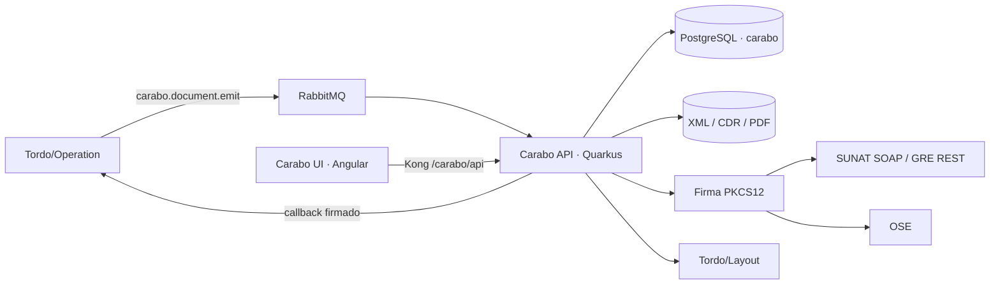

# TORDO-APP-005 — Carabo Facturación Electrónica

| Metadato | Valor |
|---|---|
| Código | TORDO-APP-005 |
| Versión | 1.0 — baseline, ejecución y tablero de trazabilidad |
| Fecha | 2026-10-16 |
| Estado | Desplegado parcialmente en DEV; no homologado ni listo para producción |
| Primer país | Perú — SUNAT |
| Audiencia | Producto, Arquitectura, Desarrollo, QA, DevOps, Seguridad, Operaciones y especialista fiscal |

> **Control de alcance.** Esta ficha distingue alcance escrito, código existente, capacidad verificable en DEV y capacidad aceptada para producción. Una clase, endpoint o pantalla no demuestra cumplimiento tributario. Ningún tipo documental, GRE, OSE o país se declara productivo sin pruebas, homologación y evidencia operativa.

> **Lectura rápida.** El [tablero integral](#tablero-integral-de-avance-y-trazabilidad) registra el estado real; la tabla `CAR-001..034` guía la ejecución. “Build verde” no significa “flujo fiscal homologado” y “desplegado en DEV” no significa “aceptado para producción”.

## Objetivo

Poner en producción un servicio multitenant de facturación electrónica para Perú que genere, firme, envíe, consulte y conserve comprobantes electrónicos, con integración confiable con Tordo/Operation, SUNAT u OSE y Tordo/Layout.

## Diagnóstico ejecutivo

El repositorio contiene una base funcional amplia: backend Quarkus modular, frontend Angular, modelo de datos, generación UBL, firma XML, clientes SUNAT/OSE, GRE, procesamiento por RabbitMQ, almacenamiento, reportes y despliegue con Docker. Sin embargo, todavía no debe considerarse listo para producción.

Hallazgos principales:

- No existen pruebas automatizadas de backend ni frontend.
- La compilación backend fue validada con Java 21 y Gradle 8.14; el build finaliza correctamente, aunque todavía no contiene pruebas automatizadas que demuestren el comportamiento fiscal e integraciones.
- El filtro de API key autentica un tenant, pero los recursos aceptan `businessCode` e identificadores sin comprobar que pertenezcan al tenant autenticado. Esto permite acceso cruzado entre tenants.
- Los endpoints de tenants retornan la entidad completa, que contiene credenciales SOL, contraseña de certificado, token OSE, secreto de webhook y API key.
- La numeración usa `MAX(number) + 1`; bajo concurrencia puede producir correlativos duplicados.
- El consumidor RabbitMQ captura la excepción y termina normalmente, sin estrategia explícita de ACK/NACK, reintentos ni cola de mensajes muertos.
- Los callbacks son asíncronos pero no persistentes; no tienen política verificable de reintentos, timeout o auditoría de entrega.
- Las migraciones son scripts manuales y no están integradas con Flyway/Liquibase ni verificadas automáticamente al desplegar.
- El README y las rutas/configuración no están totalmente alineados: documentación `/api/...`, recursos backend `/documents`, frontend productivo `/api` y Nginx `/carabo/api/`.
- El README declara documentos en “Producción”, pero no hay evidencia automatizada de homologación SUNAT, validación XSD/schematron, pruebas con certificados ni pruebas end-to-end.
- Chile, Colombia y México están registrados como soportados, aunque sus estrategias declaran estado `STUB`.
- No se observan métricas de negocio, trazas, alertas, respaldo probado ni procedimiento de recuperación.

## Alcance recomendado para la primera salida

Incluido:

- Perú/SUNAT.
- Factura, boleta, nota de crédito y nota de débito.
- SUNAT directo como camino principal; OSE se habilita solo después de pruebas contractuales con un proveedor concreto.
- Emisión REST y asíncrona por RabbitMQ.
- XML firmado, CDR, representación PDF, consulta y reintento controlado.
- Aislamiento multitenant, observabilidad, respaldo y operación documentada.

Fuera de la primera salida:

- Chile, Colombia y México.
- Activación productiva de GRE hasta completar el ciclo de ticket/consulta y homologación.
- Soporte genérico para múltiples OSE sin adaptadores y pruebas por proveedor.

## Objetivos y resultados

| ID | Objetivo | Métrica orientativa | Prioridad |
|---|---|---|---|
| OBJ-01 | Emitir sin pérdida ni duplicidad | Conciliación venta-documento; duplicados | P0 |
| OBJ-02 | Aislar empresas y secretos | Pruebas cross-tenant; secretos expuestos | P0 |
| OBJ-03 | Mantener trazabilidad fiscal | % con XML, firma, CDR, logs y correlación | P0 |
| OBJ-04 | Resistir fallos externos | Edad de pendientes; retries; DLQ | P0 |
| OBJ-05 | Integrar venta y representación | % ventas con documento, callback y PDF conciliados | P1 |
| OBJ-06 | Extender canales y países con evidencia | Tipos/canales/países homologados | P2/P3 |

## Arquitectura construida

## Inventario funcional

| ID | Capacidad | Criterio de completitud | Prioridad |
|---|---|---|---|
| FUN-001 | Tenants/configuración fiscal | Alta segura, series, canal, certificados y rotación | P0 |
| FUN-002 | Factura/boleta/NC/ND | Validación, numeración, firma, envío y estado final | P0 |
| FUN-003 | UBL Perú | XML por tipo validado contra XSD y reglas SUNAT | P0 |
| FUN-004 | Firma digital | Firma externa verificable, alias y vigencia | P0 |
| FUN-005 | SUNAT directo | Envío, CDR, códigos, observaciones y consulta | P0 |
| FUN-006 | OSE | Adaptador y suite contractual por proveedor | P2 |
| FUN-007 | Custodia documental | Cifrado, checksum, retención, backup y restore | P0/P1 |
| FUN-008 | Consulta/descarga | Filtros y recursos aislados por tenant | P0 |
| FUN-009 | PDF | A4/ticket mediante Layout y plantilla aprobada | P1 |
| FUN-010 | Reintentos | Política por error, backoff y estados idempotentes | P0 |
| FUN-011 | RabbitMQ | ACK/NACK, deduplicación, retry, DLQ y correlación | P0 |
| FUN-012 | Callback/webhook | Outbox, firma, anti-replay y auditoría | P1 |
| FUN-013 | RA/RC | Envío, ticket, consulta y resultado final | P1 |
| FUN-014 | GRE 2.0 | UBL, OAuth, ticket, consulta, CDR y homologación | P2 |
| FUN-015 | Reportes | KPIs conciliables y exportación aislada | P1 |
| FUN-016 | Operación web | Emitir, consultar, descargar y reintentar | P1 |
| FUN-017 | Administración web | Configurar sin exponer secretos | P1 |
| FUN-018 | Seguridad multitenant | Contexto obligatorio en REST, jobs, storage y reportes | P0 |
| FUN-019 | Observabilidad/soporte | Logs, métricas, trazas, alertas y runbooks | P1 |
| FUN-020 | Expansión regional | Compliance y homologación por país | P3 |

## Tabla de ejecución

Convenciones: `P0` bloquea cualquier salida; `P1` bloquea producción; `P2` completa la operación; `P3` es evolución. Las estimaciones son jornadas-persona y deben recalibrarse al asignar responsables.

| ID | Fase | Prioridad | Trabajo | Entregable / resultado | Dependencias | Responsable sugerido | Estimación | Criterio de cierre | Estado inicial |
|---|---|---:|---|---|---|---|---:|---|---|
| CAR-001 | 0. Baseline | P0 | Preparar toolchain reproducible: Java 21, wrapper ejecutable, Node 22, npm lockfile y comandos únicos de build/test | Build local y CI reproducibles | Ninguna | DevOps + Backend | 1–2 d | Backend y frontend compilan desde cero en CI | 🟢 CI verde |
| CAR-002 | 0. Baseline | P0 | Crear pipeline CI con compilación, pruebas, análisis estático, escaneo de dependencias e imágenes | Workflow con controles obligatorios | CAR-001 | DevOps | 2–3 d | Un PR no puede integrarse con controles fallidos | 🟡 Tests y builds obligatorios; faltan análisis, escaneo y branch protection |
| CAR-003 | 0. Baseline | P0 | Definir contrato OpenAPI real, prefijo de rutas y estrategia de versionado | OpenAPI versionado y rutas coherentes en API, UI, Kong, Nginx y README | CAR-001 | Arquitectura + Backend | 2 d | Prueba smoke confirma todas las rutas publicadas | 🟡 Rutas DEV verificadas; contrato no versionado |
| CAR-004 | 0. Baseline | P1 | Integrar migraciones con Flyway o Liquibase | Migraciones automáticas, idempotentes y auditables | CAR-001 | Backend + DBA | 2–3 d | Base vacía y actualización desde versión anterior pasan en CI | 🟢 Flyway V1–V7; migración incremental y PostgreSQL real comprobados en CI/DEV |
| CAR-005 | 1. Seguridad | P0 | Aplicar autorización por tenant en todos los recursos y servicios | Tenant derivado de la API key; consultas por ID y listados siempre filtrados | CAR-003 | Backend + Seguridad | 3–5 d | Pruebas demuestran que una API key nunca accede a otro tenant | 🟢 CI con dos tenants prueba lista, detalle, externalId, XML, CDR y retry cruzados; revisar alcance de jobs al añadirlos |
| CAR-006 | 1. Seguridad | P0 | Separar DTOs de administración y ocultar secretos | Respuestas sin SOL password, certificado password, OSE token, webhook secret ni API key | CAR-005 | Backend | 2–3 d | Tests de contrato verifican que ningún secreto se serializa | 🟢 DTO seguro, test estructural y prueba HTTP DEV sin secretos |
| CAR-007 | 1. Seguridad | P0 | Definir rol administrativo distinto de la API key de tenant | Endpoints de alta/listado/edición de tenants restringidos | CAR-005 | Arquitectura + Seguridad | 3–5 d | Tenant común no puede administrar tenants | 🟡 JWT/JWKS y roles Carabo desplegados; smoke anónimo/API key pasa, falta sesión humana E2E |
| CAR-008 | 1. Seguridad | P1 | Externalizar y cifrar secretos; definir rotación de API keys y certificados | Integración con secret store y runbook de rotación | CAR-006 | DevOps + Seguridad | 3–5 d | No hay secretos sensibles en BD en texto claro ni en respuestas/logs | 🟡 Secret store montado en DEV, API keys rotables y carga PKCS#12 validada mediante `secret://`; faltan migración histórica y runbook formal de rotación |
| CAR-009 | 1. Seguridad | P1 | Endurecer XML y salidas HTTP: XXE, SSRF de callbacks, timeouts y límites de tamaño | Parsers y clientes HTTP seguros | CAR-005 | Backend + Seguridad | 2–4 d | Pruebas negativas de XXE/SSRF/timeouts pasan | 🟡 Parser XMLDSig resistente a XXE; callbacks validan HTTP(S), DNS/red privada y timeout; faltan pruebas negativas integrales y límites en todos los clientes |
| CAR-010 | 2. Núcleo fiscal | P0 | Sustituir `MAX + 1` por correlativos transaccionales por tenant/serie/tipo | Tabla o secuencia bloqueada con asignación atómica | CAR-004 | Backend + DBA | 3–4 d | Prueba concurrente no genera huecos indebidos ni duplicados | 🟢 Contador atómico V3 desplegado; CI asignó 40/40 correlativos contiguos y únicos |
| CAR-011 | 2. Núcleo fiscal | P0 | Validar reglas fiscales, redondeos y tipos de afectación | Motor de validación con casos gravados, exonerados, inafectos, gratuitos, descuentos y anticipos definidos en alcance | CAR-010 | Backend + Especialista fiscal | 5–8 d | Batería de casos dorados concilia bases, impuestos y total | 🟡 Gravado/exonerado/inafecto/exportación y redondeo cubiertos; faltan gratuitos, anticipos y revisión fiscal |
| CAR-012 | 2. Núcleo fiscal | P0 | Validar UBL con XSD y reglas SUNAT antes del envío | Validador estructural y reporte de errores accionable | CAR-011 | Backend | 4–6 d | XML de cada tipo pasa XSD/reglas y casos inválidos son rechazados | 🟡 XSD OASIS 2.1 aplicado antes de firma para factura, boleta, NC y ND; reglas de serie, totales y catálogos 09/10 probadas; faltan reglas SUNAT completas y homologación |
| CAR-013 | 2. Núcleo fiscal | P0 | Certificar firma XML y manejo de certificados | Firma compatible con SUNAT, selección segura de alias y control de vigencia | CAR-008, CAR-012 | Backend + Seguridad | 3–5 d | Firma verificada externamente; certificados vencidos o inválidos fallan de forma controlada | 🟡 Verificación XMLDSig independiente, detección de alteración, alias persistido/seleccionado y vigencia probados; faltan cadena de confianza/revocación e interoperabilidad SUNAT |
| CAR-014 | 2. Núcleo fiscal | P0 | Completar estados y transiciones del documento | Máquina de estados explícita e idempotente | CAR-011 | Backend | 3–4 d | No existen regresiones de estado y cada transición queda auditada | 🟢 Política persistida de backoff, límite, estado terminal, intento anterior/siguiente y reintento manual/automático; faltan pruebas de resiliencia |
| CAR-015 | 2. Núcleo fiscal | P1 | Completar RA/RC y consulta de tickets | Flujo asíncrono completo hasta CDR y estado final | CAR-012, CAR-014 | Backend + Fiscal | 5–8 d | Casos aceptado, observado, rechazado y error transitorio probados | 🟢 Operación durable, identificador atómico por tenant, ticket, consulta, CDR e historial UI; falta E2E SUNAT real |
| CAR-016 | 2. Núcleo fiscal | P1 | Completar GRE 2.0 o mantenerla deshabilitada | Ciclo envío-ticket-consulta-CDR y validación GRE | CAR-012, CAR-014 | Backend + Fiscal | 5–8 d | Homologación GRE superada; hasta entonces feature flag desactivado | 🟡 Envío, ticket persistido, polling, CDR/XML cifrados, PDF y monitor UI desplegados; falta homologación |
| CAR-017 | 3. Integración | P0 | Diseñar entrega RabbitMQ confiable | ACK/NACK correcto, reintentos con backoff, DLQ y deduplicación | CAR-014 | Backend + DevOps | 4–6 d | Fallos transitorios reintentan; poison messages llegan a DLQ; no hay doble emisión | 🟡 Ingesta HTTP asíncrona, ACK del broker, NACK de payload inválido, backpressure y DLQ configurados; falta prueba real de reentrega/DLQ |
| CAR-018 | 3. Integración | P0 | Reforzar idempotencia REST y mensajes | Clave idempotente única por tenant/origen y respuesta repetible | CAR-010, CAR-017 | Backend + DBA | 3–4 d | Solicitudes simultáneas iguales generan un solo documento | 🟡 Header/IDs únicos y advisory locks desplegados; falta prueba E2E simultánea REST/MQ |
| CAR-019 | 3. Integración | P1 | Implementar outbox para eventos/callbacks | Notificaciones persistidas y desacopladas de la transacción fiscal | CAR-014, CAR-017 | Backend | 4–6 d | Caída del receptor no pierde eventos y permite replay seguro | 🟢 Outbox durable por tenant/documento/estado con deduplicación, reintentos y estado terminal desplegado |
| CAR-020 | 3. Integración | P1 | Formalizar callbacks/webhooks | HMAC versionado, timestamp anti-replay, timeout, backoff y auditoría | CAR-009, CAR-019 | Backend | 3–4 d | Entrega, reintento, firma y replay están cubiertos por pruebas | 🟢 HMAC `v1`, timestamp, event ID, timeout, backoff y auditoría visible; faltan pruebas externas de replay |
| CAR-021 | 3. Integración | P1 | Probar integración Tordo/Operation y Layout | Contratos, fixtures y pruebas de integración entre servicios | CAR-003, CAR-018, CAR-020 | Backend + Equipos Tordo | 4–6 d | Venta aprobada termina en documento, callback y PDF verificables | Pendiente |
| CAR-022 | 3. Integración | P2 | Crear adaptador por OSE seleccionado | Contrato aislado, mapeo de errores y pruebas sandbox | CAR-014 | Backend | 4–8 d/proveedor | Suite contractual aprobada por proveedor | 🟡 Contrato Carabo OSE Gateway aislado y probado localmente; proveedor comercial aún no seleccionado |
| CAR-023 | 4. Calidad | P0 | Pruebas unitarias de dominio, UBL, firma, validación y numeración | Suite rápida de regresión | CAR-010–CAR-014 | Backend QA | 6–10 d | Cobertura de reglas críticas y todos los casos fiscales definidos | 🟡 Casos dorados, XSD por tipo, XMLDSig/alteración/alias/vigencia, seguridad e idempotencia en CI; falta matriz fiscal completa |
| CAR-024 | 4. Calidad | P0 | Pruebas de integración con PostgreSQL y RabbitMQ reales | Suite con contenedores para persistencia y mensajería | CAR-004, CAR-017 | Backend QA | 4–6 d | Pipeline reproduce fallos, reintentos e idempotencia | 🟡 PostgreSQL 16 y concurrencia integrados al CI; falta RabbitMQ/fallos/reintentos |
| CAR-025 | 4. Calidad | P1 | Pruebas E2E de API y UI | Flujos de emisión, búsqueda, descarga, retry, reportes y configuración | CAR-021 | QA + Frontend | 5–8 d | Flujos críticos pasan en entorno efímero | 🟡 Smoke HTTP cross-tenant real en CI; runner SUNAT completo preparado; faltan UI y sandbox fiscal |
| CAR-026 | 4. Calidad | P1 | Pruebas de carga, concurrencia y resiliencia | Límites operativos y SLO basados en evidencia | CAR-024 | QA + DevOps | 3–5 d | Se cumplen volumen diario, latencia y recuperación acordados | Pendiente |
| CAR-027 | 4. Calidad | P1 | Homologación SUNAT con evidencias | Matriz de casos, XML, CDR y acta de resultado | CAR-012–CAR-016, CAR-023 | QA + Fiscal | 5–10 d | Todos los tipos en alcance están homologados | Pendiente |
| CAR-028 | 5. Operación | P1 | Añadir observabilidad | Logs estructurados sin secretos, correlation ID, métricas, trazas y dashboards | CAR-017, CAR-019 | DevOps + Backend | 4–6 d | Alertas detectan cola detenida, tasa de rechazo, latencia y expiración de certificados | 🟡 Correlation ID/MDC, métricas Prometheus y consola operativa de callbacks desplegados; faltan dashboards, trazas y alertas |
| CAR-029 | 5. Operación | P1 | Definir almacenamiento, retención, cifrado y respaldo | Política y jobs de backup de BD/XML/CDR/PDF | CAR-008 | DevOps + Seguridad | 3–5 d | Restauración completa probada con RPO/RTO acordados | 🟡 AES-256-GCM/checksum/escritura atómica; backup/restore DEV 2026-10-16 conservó tenant e inventario; faltan RPO/RTO y retención aprobada |
| CAR-030 | 5. Operación | P1 | Endurecer despliegue | Imágenes fijadas, usuario no root, health/readiness, recursos y rollback | CAR-002, CAR-028 | DevOps | 3–5 d | Despliegue y rollback ensayados sin pérdida de documentos | 🟡 Imágenes CI y health DEV |
| CAR-031 | 5. Operación | P1 | Crear runbooks y soporte | Procedimientos para caída SUNAT/OSE, DLQ, certificados, reenvíos y recuperación | CAR-027–CAR-030 | Operaciones | 2–4 d | Guardia puede resolver simulacros usando solo el runbook | Pendiente |
| CAR-032 | 6. Salida | P1 | Piloto controlado con un tenant y series de prueba | Operación paralela, monitoreo y conciliación diaria | CAR-025–CAR-031 | Producto + Operaciones | 5–10 d | Cero pérdida/duplicidad y conciliación 100 % durante el piloto | Pendiente |
| CAR-033 | 6. Salida | P1 | Go-live progresivo | Activación por tenant con feature flags y plan de reversa | CAR-032 | Producto + Operaciones | 2–5 d | Checklist aprobado y SLO estable durante ventana acordada | Pendiente |
| CAR-034 | 7. Evolución | P3 | Implementar países adicionales como proyectos independientes | Compliance, modelo, firma, transporte y homologación por país | CAR-033 | Producto + Arquitectura | Por estimar | Ningún país se declara soportado sin homologación propia | Pendiente |

## Secuencia sugerida

| Ola | Semanas orientativas | Objetivo | Ítems principales | Puerta de salida |
|---|---:|---|---|---|
| 1 | 1–2 | Baseline y contención de riesgos críticos | CAR-001–CAR-010 | Build verde, rutas coherentes, aislamiento tenant probado y correlativos seguros |
| 2 | 3–5 | Núcleo fiscal Perú confiable | CAR-011–CAR-016, CAR-023 | Casos fiscales, UBL, firma y estados cubiertos por pruebas |
| 3 | 5–7 | Integración resiliente | CAR-017–CAR-022, CAR-024 | Mensajería, idempotencia, callbacks y contratos Tordo verificados |
| 4 | 7–9 | Homologación y operación | CAR-025–CAR-031 | Homologación, carga, observabilidad, backup/restore y rollback aprobados |
| 5 | 10–11 | Piloto y salida gradual | CAR-032–CAR-033 | Conciliación 100 %, sin duplicidad ni pérdida, SLO estable |

La duración supone un equipo mínimo de 2 backend, 1 frontend compartido, 1 QA, 1 DevOps compartido y disponibilidad de un especialista fiscal. Con una sola persona, no debe interpretarse como calendario: las jornadas-persona se mantienen, pero las olas se vuelven mayormente secuenciales.

## Camino crítico

`Build/CI → aislamiento multitenant → correlativos → reglas fiscales → UBL/firma → estados → idempotencia/mensajería → integración E2E → homologación → piloto → producción`

GRE y OSE pueden ejecutarse en paralelo después de estabilizar el núcleo, pero no deben bloquear el MVP si se mantienen desactivados mediante configuración.

## Criterios de “listo para producción”

- Un tenant no puede leer, modificar, emitir, descargar ni reportar datos de otro tenant.
- Ningún secreto aparece en respuestas, logs, repositorio o imágenes.
- La numeración y la idempotencia resisten concurrencia y reentregas.
- Cada documento del alcance tiene casos fiscales dorados, XML válido, firma válida y evidencia de homologación.
- RabbitMQ, callbacks y SUNAT/OSE pueden fallar sin perder ni duplicar documentos.
- Se puede rastrear una operación completa mediante correlation ID.
- Backup y restauración están probados; despliegue y rollback tienen runbook.
- El piloto concilia el 100 % de ventas, documentos, estados, CDR y totales.

## Decisiones pendientes

| Decisión | Opciones | Recomendación | Fecha límite relativa |
|---|---|---|---|
| Canal inicial | SUNAT directo / OSE | SUNAT directo para MVP; un OSE concreto como fase posterior | Antes de CAR-011 |
| Alcance GRE | Incluir / diferir | Diferir salvo necesidad comercial inmediata | Antes de CAR-016 |
| Autoridad administrativa | API key maestra / OIDC y roles | OIDC/roles del ecosistema Tordo | Antes de CAR-007 |
| Gestión de secretos | Docker secrets / Vault / servicio cloud | Reutilizar el gestor corporativo existente | Antes de CAR-008 |
| Persistencia de archivos | Volumen local / objeto S3 compatible | Objeto durable con versionado y cifrado | Antes de CAR-029 |
| Objetivos operativos | RPO, RTO, latencia, disponibilidad, volumen | Definir con Producto y Operaciones usando el piloto | Antes de CAR-026 |

## Riesgos que requieren seguimiento semanal

| Riesgo | Probabilidad | Impacto | Mitigación | Indicador |
|---|---|---|---|---|
| Interpretación fiscal incompleta | Alta | Crítico | Especialista fiscal, casos dorados y homologación temprana | Rechazos por código SUNAT |
| Fuga entre tenants o de credenciales | Alta | Crítico | CAR-005–CAR-009 como P0 | Pruebas negativas y hallazgos de seguridad |
| Duplicidad por concurrencia o reentrega | Alta | Crítico | Correlativos transaccionales, idempotencia y DLQ | Duplicados por clave de origen/serie |
| Dependencia inestable de SUNAT/OSE | Alta | Alto | Backoff, circuit breaker, estado asíncrono y operación degradada | Error rate y edad de pendientes |
| Divergencia entre documentación y despliegue | Media | Alto | OpenAPI como contrato y smoke tests | Rutas fallidas después de deploy |
| Pérdida de XML/CDR/PDF | Media | Crítico | Storage durable, checksums, backup y restore probado | Objetos faltantes o checksum inválido |
| Expiración de certificados | Media | Crítico | Inventario y alertas 60/30/15 días | Días restantes por tenant |

## Gobierno del plan

- Actualizar semanalmente `Estado`, responsable, fecha objetivo y evidencia de cada ítem.
- No cerrar una tarea por “código terminado”; debe cumplirse el criterio de cierre y enlazarse la evidencia.
- No iniciar el piloto con un P0 abierto.
- No activar un tipo documental, GRE, OSE o país sin su propia evidencia contractual y de homologación.

## Evaluación contra el estado construido

### Evidencia verificable al 2026-10-16

| Evidencia | Resultado |
|---|---|
| GitHub Actions Carabo `38915938962` | Tests API/UI/PostgreSQL y construcción de imágenes API/UI completados; sólo falló el dispatch por ausencia de `PLATFORM_DEPLOY_TOKEN` |
| Commit Carabo desplegado | `8aef2c3e10b2` en `develop`; versión `0.2.0-develop.8aef2c3e10b2` |
| Despliegue | API/UI actualizadas manualmente en serie para proteger la RAM; ambos contenedores saludables |
| API pública | `https://dev.tordo.io/carabo/api/health` → `200 OK` |
| UI pública | `https://dev.tordo.io/carabo/ui/` → `200 OK` |
| Contrato exploratorio | `/carabo/api/swagger/` y `/carabo/api/q/openapi` → `200` |
| PostgreSQL/Flyway | DEV en V6; correlativos, secretos, firma y timestamps UTC `TIMESTAMPTZ` aplicados y validados en PostgreSQL 16 |
| Seguridad HTTP | Sin credencial, documentos responde `401`; CI prueba accesos cross-tenant negativos en lista, detalle, externalId, XML, CDR y retry |
| Layout | 5 plantillas `ELECTRONIC_*` cargadas |
| RabbitMQ | Cola `carabo.document.emit`, un consumidor activo |
| Runtime | Quarkus 3.18.4, Java 21, perfil prod y broker conectado |

### Hallazgos bloqueantes

| ID | Hallazgo | Impacto | Severidad | Estado |
|---|---|---|---|---|
| ASB-01 | El límite REST deriva tenant de la credencial y los recursos filtran por contexto | Acceso cruzado | Crítica | Resuelto para REST con fixtures adversariales HTTP; mantener regresión al crear jobs nuevos |
| ASB-02 | Las respuestas usan DTO sin secretos | Fuga de secretos | Crítica | Resuelto en DEV con prueba HTTP y test estructural |
| ASB-03 | La numeración usaba `MAX(number)+1` | Duplicados concurrentes | Crítica | Resuelto en DEV con contador atómico V3 y prueba 40/40 |
| ASB-04 | Existe suite mínima obligatoria; faltan dominio, integración y compliance | Evidencia insuficiente | Alta | Mitigación parcial |
| ASB-05 | Validación fiscal todavía no cubre toda la matriz SUNAT | XML inválido/rechazos | Alta | Mitigación parcial: XSD por tipo y reglas base/catálogos 07/09/10 pasan en CI |
| ASB-06 | No se demostró ACK/NACK, DLQ ni retry del consumer | Pérdida silenciosa | Crítica | Mitigación parcial: NACK/DLQ/backpressure configurados; falta prueba con caída y reentrega real |
| ASB-07 | Callback no persistente | Notificaciones perdidas | Alta | Resuelto con outbox durable V7, backoff y auditoría por tenant |
| ASB-08 | Migraciones del schema Carabo administradas por Flyway V1–V7 | Drift y despliegue no reproducible | Alta | Resuelto en CI/DEV |
| ASB-09 | Credenciales fiscales históricas continúan en BD hasta su migración a referencias `secret://` | Compromiso de tenant | Crítica | Mitigación parcial; API keys ya no se almacenan en claro |
| ASB-10 | README ya distingue implementación de homologación/producción | Expectativa incorrecta | Alta | Resuelto |
| ASB-11 | CL/CO/MX están registrados aunque sus estrategias son stubs | Falso soporte regional | Alta | Pendiente |
| ASB-12 | El job de dispatch CI→Tordo.Platform falló después del build | Deploy manual | Alta | Pendiente |
| ASB-13 | El entorno efectivo incorpora perfil, secretos, cifrado y servicios Carabo | Redeploy global o administración incompleta | Alta | Resuelto en DEV |

## Tablero integral de avance y trazabilidad

### Método de medición

| Estado | Rango | Significado |
|---|---:|---|
| ✅ Aceptado | 100% | UAT/operación aprobó y no hay bloqueantes |
| 🟢 Verificable DEV | 75–99% | Build, despliegue y prueba funcional con evidencia |
| 🟡 Parcial | 25–74% | Existe una parte útil; faltan criterios relevantes |
| ⚪ Incipiente | 1–24% | Código/diseño inicial sin flujo verificable |
| ⛔ No iniciado | 0% | No existe evidencia implementada |

Ningún porcentaje sube por documentación, mocks o clases aisladas. Un endpoint saludable demuestra despliegue, no cumplimiento fiscal. Para 100% se requiere aceptación y cierre de defectos bloqueantes.

### Resumen ejecutivo de avance

| Dimensión | Avance | Estado | Evidencia/falta principal |
|---|---:|---|---|
| Alcance y arquitectura | 85% | 🟢 | Objetivo, fronteras, backlog, riesgos y puertas definidos |
| Fundación técnica DEV | 94% | 🟢 | CI con tests API/UI/PostgreSQL/RabbitMQ, imágenes, Flyway V7 y despliegue DEV verificado; dispatch automático sigue pendiente |
| Producto funcional integral | 71% | 🟡 | Flujos manuales, custodia, retry, lotes, GRE y outbox operables; faltan reglas fiscales completas y homologación |
| MVP Perú | 76% | 🟢 | XSD, XMLDSig, transporte, reintentos y operación manual verificables; E2E beta y homologación bloquean |
| Preparación productiva | 36% | 🟡 | Restore, métricas, correlación y auditoría DEV; faltan homologación, piloto, alertas, destino externo y runbooks aprobados |
| Aceptación usuario/operación | 0% | ⛔ | No existe sesión UAT registrada |

### Matriz de capacidades

| ID | Avance | Estado/evidencia | Falta principal | Validación |
|---|---:|---|---|---|
| FUN-001 | 95% | 🟢 Configuración editable, DTO seguro, Auth/roles, secret store, API keys rotables y carga PKCS#12 con validación real | Migrar secretos fiscales históricos y formalizar el runbook de rotación del certificado | Verificable DEV |
| FUN-002 | 80% | 🟡 Pipeline, correlativos concurrentes, XSD por tipo y casos dorados gravado/exonerado/inafecto/exportación | Firma homologada, casos avanzados y homologación SUNAT | No lista |
| FUN-003 | 75% | 🟡 Builder corregido y validado con XSD OASIS 2.1 para factura, boleta, NC y ND; reglas de serie, conciliación y catálogos de motivo | Completar catálogos/reglas SUNAT, gratuitos/anticipos y homologación | Verificable DEV/CI, no homologada |
| FUN-004 | 78% | 🟡 RSA-SHA256 con verificación independiente, detección de alteración, alias explícito persistido, vigencia y parser anti-XXE | Validar cadena/revocación y certificar interoperabilidad con SUNAT/OSE | Verificable DEV/CI, no homologada |
| FUN-005 | 68% | 🟡 Cliente SUNAT endurecido, CDR/errores, backoff durable y runner reproducible ingestión→RabbitMQ→worker→XML→firma→SUNAT→CDR→GET | Cargar credenciales/certificado beta, ejecutar E2E real y homologar | Desarrollo listo; validación externa pendiente |
| FUN-006 | 45% | 🟡 Contrato Carabo OSE Gateway v1 probado y puerta de selección contrastada con el padrón oficial SUNAT | Contratar/seleccionar proveedor, implementar su adaptador y aprobar sandbox | No lista |
| FUN-007 | 82% | 🟢 Custodia por tenant con rutas endurecidas, AES-256-GCM, checksum SHA-256 y escritura atómica; backup/restore DEV ejecutado con manifiesto íntegro e inventario preservado | Acordar RPO/RTO, destino externo de backups y aprobar retención fiscal | Verificable CI/DEV |
| FUN-008 | 90% | 🟢 Consulta, externalId, XML, CDR, PDF y retry ligados al contexto; descargas UI autenticadas y fixtures cross-tenant HTTP | Ampliar regresión a cada job futuro y UAT de navegador | Verificable CI/DEV |
| FUN-009 | 65% | 🟡 Layout client para documentos/GRE y descargas PDF autenticadas desde UI | E2E Layout con fixtures y aprobación visual fiscal | Verificable DEV, no aprobada |
| FUN-010 | 78% | 🟢 Backoff 1/5/15/60, timestamps persistidos, límite/FAILED y retry manual/automático | Pruebas de caída, carrera y matriz de errores SUNAT/OSE | Verificable CI/DEV |
| FUN-011 | 58% | 🟡 Ingesta asíncrona externa, confirmación del broker, NACK, backpressure y DLQ configurados | E2E RabbitMQ de fallo, reentrega y DLQ; política de replay | No lista |
| FUN-012 | 82% | 🟢 Outbox durable, deduplicación, HMAC v1, timestamp/event ID anti-replay, SSRF, timeout, backoff y auditoría UI | Pruebas E2E contra receptor caído/replay y acción manual de reenvío | Verificable CI/DEV |
| FUN-013 | 75% | 🟢 RC/RA persistidos, correlativo atómico, ticket, consulta, CDR, historial y mensajes UI | Casos reales SUNAT aceptado/observado/rechazado/timeout | Verificable CI/DEV, no homologada |
| FUN-014 | 70% | 🟡 GRE UBL/firma/OAuth, ticket durable, polling automático/manual, CDR/XML cifrados, PDF y monitor UI | Validación XSD/reglas GRE, credenciales beta y homologación | Verificable DEV, no homologada |
| FUN-015 | 65% | 🟡 Reportes, KPIs y Excel descargable con autenticación | Conciliación contra casos dorados, permisos y pruebas UAT | Verificable DEV |
| FUN-016 | 85% | 🟢 UI autenticada para emitir, consultar, descargar, reintentar, lotes, GRE, reportes y operación; versiones visibles | Capturas autenticadas y UAT | Lista para sesión manual condicionada a tenant |
| FUN-017 | 65% | 🟡 Selector de empresa, roles y contexto humano en UI/API; vistas supervisor/admin separadas | E2E sesión humana adversarial cross-tenant | Verificable DEV |
| FUN-018 | 70% | 🟡 JWT humano + API key máquina, contexto obligatorio y recursos/jobs/storage filtrados por tenant | Prueba adversarial MQ/jobs completa y smoke con sesión humana | Verificable CI/DEV parcial |
| FUN-019 | 60% | 🟡 Health, correlation ID/MDC, métricas Prometheus y panel de entregas fallidas/reintentos | Dashboards, tracing distribuido, alertas y runbooks aprobados | Verificable DEV |
| FUN-020 | 5% | ⚪ Interfaces/stubs | Implementación y compliance por país | No lista |

### Checklist del MVP Perú

| # | Entregable | Avance | Evidencia/falta |
|---:|---|---:|---|
| 1 | Build reproducible API/UI | 100% | GitHub Actions verde |
| 2 | Despliegue DEV | 95% | API/UI `develop` saludables; dispatch automático aún falla por token |
| 3 | Schema/migraciones | 98% | Flyway V1–V7 automático; UTC/TIMESTAMPTZ, outbox, retry y lotes verificados en PostgreSQL CI/DEV |
| 4 | RabbitMQ conectado | 75% | Cola/consumer e ingesta externa activos; NACK/DLQ configurados, falta prueba de caída/reentrega |
| 5 | Tenant de prueba seguro | 55% | Tenant DEV, usuarios Columba y roles Carabo sembrados; falta E2E HTTP |
| 6 | Correlativos/idempotencia | 75% | Correlativo atómico probado 40/40; claves únicas y locks desplegados; falta E2E concurrente REST/MQ |
| 7 | Factura/boleta/NC/ND válidas | 72% | Los cuatro tipos pasan XSD OASIS 2.1 y reglas base; falta matriz fiscal/homologación SUNAT |
| 8 | Firma/certificado | 75% | XMLDSig se autoverifica, controla alias/vigencia y detecta alteración; falta PKI/homologación externa |
| 9 | SUNAT sandbox/CDR | 50% | SOAP/CDR/errores y runner integral preparados; flujo SUNAT beta real bloqueado por credenciales/certificado |
| 10 | XML/CDR/PDF custodiados | 82% | AES-256-GCM, checksum y rutas seguras; backup/restore DEV ejecutado con hashes e inventario preservado |
| 11 | Seguridad cross-tenant | 85% | Fixtures adversariales y smoke HTTP real en CI cubren lista, detalle, externalId, XML, CDR y retry |
| 12 | Suite automática | 70% | Tests backend/UI/PostgreSQL/RabbitMQ, custodia, tiempo UTC/Lima y cross-tenant pasan; falta sandbox fiscal real y fallos del broker |
| 13 | Observabilidad/backup/runbook | 62% | Backup/restore, métricas Prometheus, correlation ID y consola operativa DEV; faltan destino externo, alertas y RPO/RTO |
| 14 | Homologación/piloto | 0% | No iniciados |

### Cola futura de validación con usuario

| Orden | Funcionalidad | Condición previa | Qué validar | Qué no prometer |
|---:|---|---|---|---|
| 1 | Lista/detalle | CAR-005/006 | Campos, filtros, estados y mensajes | Aislamiento sin prueba adversarial |
| 2 | Emisión manual | CAR-010..014/023 | Datos, impuestos, errores y PDF | Validez SUNAT antes de homologación |
| 3 | XML/CDR/PDF | CAR-009/021 | Descarga, formato y trazabilidad | Custodia antes de backup |
| 4 | Retry/lotes | CAR-014..018/024 | Estados, límites y recuperación | Garantía sin DLQ/idempotencia |
| 5 | Configuración | CAR-006..009 | Series, canal, ambiente y certificado | Gestión productiva de secretos |
| 6 | Reportes | CAR-005/025 | Totales, filtros y exportación | Conciliación sin casos dorados |

### Regla de mantenimiento del tablero

1. Toda entrega actualiza al menos una fila `FUN`, `CAR`, UI, API o NFR y cita evidencia.
2. Construcción, despliegue, homologación y aceptación se reportan por separado.
3. Para pasar a 🟢 debe haber build verde, despliegue DEV y prueba funcional.
4. Para 100% debe existir aceptación y cierre de bloqueantes.
5. El porcentaje puede bajar si aparece una dependencia o defecto nuevo.
6. Cada UAT registra decisiones, defectos, cambios solicitados y filas afectadas.
7. Los resúmenes se recalculan desde filas hijas; no se editan para mostrar avance deseado.

## Próximos diez días hábiles propuestos

| Día | Resultado esperado | Evidencia |
|---:|---|---|
| 1 | Reparar dispatch CI→Tordo.Platform y persistir perfil DEV | Workflow verde; redeploy conserva Carabo |
| 2 | Configurar credencial admin DEV y probar DTO por HTTP | Evidencia sin secretos |
| 3 | Crear dos tenants fixture y ejecutar suite cross-tenant REST/MQ | Suite negativa |
| 4 | Correlativo transaccional e idempotencia | Test concurrente |
| 5 | Casos dorados factura/boleta/NC/ND | Fixtures conciliados |
| 6 | XSD/reglas y firma verificable | Suite XML/firma |
| 7 | SUNAT sandbox: aceptado/rechazado/timeout | XML, CDR y logs |
| 8 | RabbitMQ retry/DLQ y outbox | Pruebas de caída/reentrega |
| 9 | E2E Operation→Carabo→Layout→callback | Ejecución automatizada |
| 10 | Revisión de salida a homologación | Checklist y decisión registrada |

## Historial de cambios

| Versión | Fecha | Cambio | Estado |
|---|---|---|---|
| 1.0 | 2026-10-15 | Baseline, evaluación as-built, despliegue DEV y tablero de trazabilidad | Control de ejecución activo |
| 1.1 | 2026-10-15 | CI con pruebas, aislamiento REST, DTO seguro, credencial admin y Flyway V1/V2 | Primera ola en ejecución |
| 1.2 | 2026-10-15 | Tordo Auth compartido con Columba, roles Carabo, JWT/JWKS, versión UI/API y nueva identidad visual Lato | Desplegado en DEV; smoke técnico pasa, login humano pendiente |
| 1.3 | 2026-10-15 | Flyway V3, correlativos atómicos, idempotencia REST/MQ base, prueba PostgreSQL concurrente y contraste de navegación | Desplegado en DEV; falta E2E idempotente simultáneo |
| 1.4 | 2026-10-15 | API keys hasheadas/rotables, referencias a secret store, Flyway V4, casos fiscales dorados y contraste explícito de navegación | Desplegado en DEV; homologación y migración de secretos históricos pendientes |
| 1.5 | 2026-10-15 | Secret store montado en DEV, clave administrativa por referencia, prueba HTTP de rotación/revocación y navegación inactiva opaca | FUN-001 al 92%; FUN-002 al 72% por XSD, firma y homologación pendientes |
| 1.6 | 2026-10-16 | Acciones de configuración activas, edición fiscal validada y carga PKCS#12 con clave privada, vigencia, límite y secreto referenciado | Desplegado y probado por HTTP en DEV; FUN-001 al 95% |
| 1.7 | 2026-10-16 | XSD OASIS 2.1 por tipo, correcciones NC/ND, catálogos de motivo, XMLDSig autoverificable, alias explícito, vigencia y protección XXE | CI verde e imagen `0.2.0-develop.237d1afbb6b6` desplegada en DEV; falta homologación/PKI externa |
| 1.8 | 2026-10-16 | Flyway V7, retry durable, outbox HMAC/anti-replay, RC/RA persistidos, GRE ticket/CDR/PDF, métricas/correlación y nuevas vistas operativas | CI inicial completo verde; imágenes y `0.2.0-develop.87146869220a` desplegadas en DEV; homologaciones externas pendientes |
