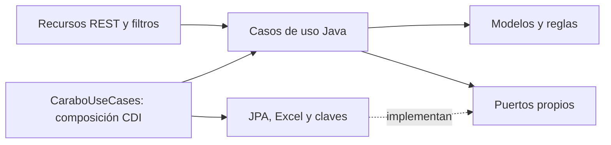

# Arquitectura backend de Carabo

Carabo adopta la separación de reglas, casos de uso, puertos y adaptadores de Tordo.Business dentro de su plataforma Java 21 / Quarkus. El núcleo privado del producto es `carabo-domain`; la API ejecutable lo compone con infraestructura. Esta entrega migra reportes e integraciones productoras de extremo a extremo. La emisión fiscal y otros servicios existentes conservan su implementación mientras se extraen con pruebas de sus garantías propias.

La referencia es `Tordo.SDK/packages/business/ARCHITECTURE.md`, junto con `Tordo.Platform/docs/homologacion-backend/06-decisiones.md` (ADR-HOM-02). Se aplica el patrón a Java; el núcleo no necesita depender de un SDK TypeScript ni distribuirse como un paquete compartido sin consumidores.



Las flechas indican dependencias de código. En ejecución, el caso de uso llama al adaptador mediante el puerto recibido por constructor.

## Mapa de responsabilidades

| Responsabilidad | Ubicación | Regla |
|---|---|---|
| Identidad de empresa, periodos y productor | `carabo-domain/io.carabo.domain` | Modelos sin JPA, HTTP, CDI, configuración ni archivos. |
| Contratos de casos de uso | `carabo-domain/io.carabo.application.*/*Contracts` | Una definición de entradas y resultados; no pertenecen al mapper JPA. |
| Casos de uso | `ReportUseCases`, `ProducerUseCases` | Reglas semánticas, totales, rotación, salud y coordinación transaccional. Reloj y claves inyectados. |
| Puertos | `carabo-domain/io.carabo.application.*/ports` | Operaciones del producto; ninguna firma expone EntityManager, SQL, Response o POI. |
| Contratos fiscales existentes | `carabo-domain/io.carabo.core.dto` y `.enums` | Se conservan los paquetes Java y campos para no duplicar contratos ni romper consumidores. |
| Persistencia nueva | `carabo-starter-quarkus/.../infrastructure/persistence` | Consultas, bloqueos, transacciones, entidades y traducción de errores SQL. |
| Excel | `.../infrastructure/export/PoiSalesWorkbook` | Codificación XLSX, ventana de filas y limpieza de temporales. |
| HTTP | `.../rest`, `.../security`, `.../infrastructure/http` | Autenticación, traducción de entrada/salida y errores HTTP. No deciden reglas de productores o reportes. |
| Composición | `.../composition/CaraboUseCases` | Fábricas CDI que conectan puertos y casos de uso. |
| Fiscal existente | `carabo-core`, módulos de firma, SUNAT, OSE y almacenamiento; servicios no migrados | Infraestructura y orquestación pendientes de extracción. `carabo-core` todavía no es un dominio puro. |

`carabo-domain` es una biblioteca del mismo proceso. No agrega otro contenedor, JVM, servicio HTTP ni base de datos.

## Reportes

`ReportResource` obtiene la empresa exclusivamente de `TenantContext`. La query `businessCode` sigue aceptándose por compatibilidad y no cambia el ámbito autenticado. `ReportPeriod` comprueba fechas y mes; `ReportUseCases` calcula los totales con `BigDecimal` y consume `ReportReader`.

`JpaReportReader` filtra empresa, estado `ACCEPTED` y periodo en SQL. Las consultas devuelven proyecciones: no materializan `Document`, líneas, impuestos ni logs. El Excel consume un cursor dentro de una transacción, con fetch size de 250; el consumidor se ejecuta antes de cerrar el cursor. Una sola consulta conserva una vista consistente de sus filas.

`PoiSalesWorkbook` usa una ventana de 100 filas y elimina temporales tanto al completar como al fallar. Se conservan hojas, columnas, resumen y nombre de descarga. La respuesta HTTP aún contiene el XLSX completo como `byte[]`; por tanto el consumo no es constante con el tamaño final del archivo. Las pruebas verifican 600 documentos en el lector y 350 filas en Excel, superando ambas ventanas.

Los periodos ausentes, mal formados o invertidos devuelven `400` con `{ "error": "..." }`. Se conservan las rutas `/reports/sales`, `/reports/monthly` y `/reports/export/excel`, los nombres de campos y los tipos de importes.

## Integraciones productoras

`ProducerUseCases` valida código, nombre, descripción y scopes desde cualquier transporte. Decide creación, rotación, activación, sincronización heredada y estado de salud. `ProducerKeys` genera la clave y su huella con el adaptador de seguridad existente. Solo las respuestas de creación y rotación entregan la clave en claro; el listado y estado exponen `ProducerSummary`, sin huella ni credencial. Los `toString()` del modelo y la credencial ocultan estos valores.

`ProducerUnitOfWork.transaction` aporta un `ProducerStore` ligado a una empresa y a una transacción. JPA usa `REQUIRED`: se une a la transacción de creación/rotación de tenant, o abre y confirma la suya antes de devolver la credencial. El dominio comprueba que el almacén y los modelos pertenecen al ámbito solicitado. Las búsquedas por ID y código añaden empresa en SQL; rotación y revocación conservan bloqueo pesimista hasta el commit. La unicidad de código por empresa y huella se mantiene en PostgreSQL. Un conflicto de unicidad devuelve `409`; otros fallos de persistencia se propagan.

`independentTransaction` usa `REQUIRES_NEW` para registrar actividad después de conocer el estado HTTP. El incremento de contadores es un `UPDATE` atómico por ID y empresa. No se usa el patrón de leer, incrementar en Java y sobrescribir, que perdía incrementos concurrentes. La prueba PostgreSQL comprueba 80 solicitudes concurrentes y rechazo de actividad de otra empresa.

`ProducerDirectory.list` obtiene productor, cantidad de documentos y última fecha en una sola consulta agregada. El JOIN también comprueba la empresa del documento. La autenticación por huella es el único acceso que descubre la empresa antes de conocerla; exige productor activo y el filtro verifica además el tenant habilitado y los permisos del recurso.

## Cambios observables y memoria

| Área | Antes | Ahora | Efecto esperado |
|---|---|---|---|
| Núcleo | Contratos mezclados con JPA/UBL | JAR sin dependencias de ejecución, casos de uso sin framework | Pruebas y reutilización del núcleo sin arrancar Quarkus. |
| Listado de N productores | Una consulta de listado y dos por productor | Una consulta agregada | Menos viajes a PostgreSQL. |
| Excel | Lista completa de entidades y workbook completo | Proyecciones por cursor y workbook con ventana de filas | Menor memoria temporal durante exportaciones. |
| Actividad | Contadores leídos y sobrescritos | Incremento SQL atómico y acotado a empresa | Contadores correctos bajo concurrencia. |
| Credenciales | Reglas repartidas entre REST y servicio JPA | Caso de uso común con puertos y unidad de trabajo | Validación coherente y rollback comprobable. |

Esta separación no fija `Xmx`, no reduce por sí sola el heap reservado de Quarkus y no permite atribuirle una cifra de ahorro en reposo. La comparación Carabo/Anser requiere medir ambos con carga y límites equivalentes. Los cambios de consultas y exportación reducen trabajo y retención durante esos flujos; el ahorro debe medirse después del despliegue correspondiente.

La [comparación posterior con carga mínima](performance-2026-11-06/README.md) mide las versiones anterior y actual en réplicas aisladas con límites equivalentes. Registra las mejoras locales de productores y Excel, las operaciones que no mejoraron y el pico de memoria durante exportaciones. No sustituye una medición en las instalaciones existentes.

## Alcance pendiente

| Flujo | Límite a extraer | Garantía que debe conservarse |
|---|---|---|
| Emisión de comprobantes | Casos de uso, modelo fiscal, repositorio, firma, autoridad y artefactos | Idempotencia por empresa, numeración del productor, reversión local y resultado externo incierto. |
| GRE y procesamiento | Reclamación duradera, puertos SUNAT/almacenamiento y política de estados | Persistir la reclamación antes del envío, no reenviar un resultado incierto, conservar CDR y rechazo terminal. |
| Lotes RC/RA y reintentos | Estados, elegibilidad, tickets y adaptadores | Recuperación por ticket, reintentos acotados y evidencia fiscal inmutable. |
| Configuración y secretos del tenant | Contratos de configuración y puertos de credenciales/certificados | Escrituras relacionadas en una transacción, secretos ausentes de respuestas y aislamiento de referencias. |
| Notificaciones y correo | Políticas y puertos de outbox, render y entrega | Outbox durable, deduplicación y reintentos sin perder evidencia. |
| Acceso humano | Membresías y roles mediante puertos | Sesión, membresía, licencia y autorización comprobadas por separado. |

No se introducen garantías de transacción distribuida por mover código. Una llamada SUNAT, un archivo y un commit PostgreSQL no admiten rollback conjunto. La siguiente extracción fiscal debe probar duplicados, fallo después del envío y confirmación perdida antes de sustituir la orquestación.

## Verificación

Desde `apps/api`:

```sh
./gradlew :carabo-domain:check --no-daemon
./gradlew check :carabo-starter-quarkus:quarkusBuild --no-daemon
```

`checkArchitecture` comprueba que el JAR del núcleo solo depende de `java.base` mediante `jdeps` y que su classpath de ejecución no tiene dependencias externas. Está integrado en `check` y en el workflow de imágenes. Las pruebas unitarias usan puertos; las pruebas de persistencia levantan PostgreSQL efímero, aplican las migraciones del repositorio y eliminan su contenedor. No se conectan a bases de desarrollo ni de producción.

Las pruebas cubren separación por empresa, rollback, rotación/revocación, errores, importes exactos, límites de fechas, proyecciones sin carga de entidades, una consulta de listado, contadores concurrentes y limpieza de temporales. El smoke HTTP de aislamiento existente sigue ejecutándose en CI después de compilar la API.

Validación local de esta entrega, 2026-11-06: `check` y `quarkusBuild` completados, 133 pruebas sin fallos ni omisiones. Un smoke adicional contra la API compilada, PostgreSQL y RabbitMQ efímeros pasó 17 comprobaciones HTTP: composición CDI, contratos seguros, errores 400/409, aislamiento, actividad concurrente con `REQUIRES_NEW`, rotación/revocación, reportes, Excel y sincronización de la credencial heredada en la transacción del tenant. Se eliminaron los contenedores de prueba al finalizar. Esta validación no desplegó cambios ni midió RAM de las instalaciones existentes.
